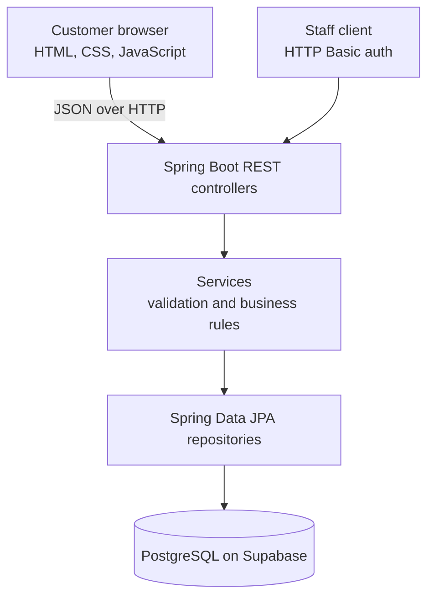

<div align="center">

# 🍽️ Plateable Eats

**A full-stack restaurant ordering demo built with Java, Spring Boot, PostgreSQL and vanilla JavaScript.**

Browse the menu, build a basket and place a demo order through a real REST API.

[**View the website**](https://platable-eats.vercel.app) · [**Explore the code**](https://github.com/Banelenelson02/platable_eats) · [**API documentation**](https://platable-eats.vercel.app/swagger-ui/index.html)


[](https://github.com/Banelenelson02/platable_eats/actions/workflows/test.yml)
[](LICENSE)

</div>

> [!IMPORTANT]
> **Portfolio demonstration, not a real restaurant service.** The checkout endpoint saves demo orders and returns an order reference. No payments are collected, and orders are not fulfilled. Please do not submit genuine customer information.

## Why I built this

Plateable Eats began as a Java object oriented design exercise with menu items, orders, tables and reservations held in memory. As the requirements grew, I rebuilt it as a layered Spring Boot application backed by PostgreSQL.

The goal was to understand the journey from domain modelling to a working web application: REST endpoints, validation, persistence, access control, automated testing and deployment. The frontend deliberately uses browser-native JavaScript instead of a framework.

## What it does

### Customer experience

- **Explore the menu:** Browse featured dishes, filter by category and search the menu.
- **Build a basket:** Add food, adjust quantities and see a running total in South African rand.
- **Place a demo order:** Enter delivery details and submit the basket to `POST /api/checkout`.
- **Get confirmation:** Receive an order reference and a total calculated by the server.
- **Use it on a phone:** Responsive layouts, accessible controls and a mobile-friendly basket and checkout.
- **Enjoy the details:** Animated intro, rotating featured dishes and image optimisations.

### Backend capabilities

- REST APIs for menu items, orders, restaurant tables and reservations.
- PostgreSQL persistence using Spring Data JPA and Hibernate.
- Input validation with Jakarta Bean Validation.
- Staff-only management routes protected by Spring Security HTTP Basic authentication.
- Interactive OpenAPI documentation through Swagger UI.
- Health endpoint through Spring Boot Actuator.
- Automated Java integration tests and a Playwright mobile checkout regression test.

**Checkout behaviour:** The browser sends menu item IDs and quantities. The server fetches current prices and availability from the database, validates the request and saves the order. It does not trust prices sent by the browser.

## Tech stack

| Part | Technologies |
| --- | --- |
| Frontend | HTML5, CSS3, vanilla JavaScript, Fetch API |
| Backend | Java 17, Spring Boot 3.3, Spring MVC |
| Persistence | PostgreSQL (Supabase), Spring Data JPA, Hibernate |
| Security and validation | Spring Security, BCrypt, Jakarta Bean Validation |
| Documentation and health | SpringDoc OpenAPI, Swagger UI, Spring Boot Actuator |
| Testing | JUnit 5, Spring Boot Test, H2, Playwright |
| Build and deployment | Maven, Docker, GitHub Actions, Vercel Containers |

## Architecture



The backend separates HTTP handling, business rules, data access and domain models. The same application also serves the frontend from `src/main/resources/static`.

### Checkout flow

1. The frontend loads menu IDs, prices and availability from `GET /api/menu`.
2. A customer adds items to the basket and fills in the demo checkout form.
3. `POST /api/checkout` validates the request and checks the selected items against PostgreSQL.
4. The backend saves the order and returns an ID, status, item count and total.
5. The page displays a confirmation without charging the customer.

## API overview

| Method | Route | Access | Purpose |
| --- | --- | --- | --- |
| `GET` | `/api/menu` | Public | List menu items |
| `GET` | `/api/menu/{id}` | Public | Fetch one menu item |
| `POST` | `/api/checkout` | Public | Create a demo delivery order |
| `GET` | `/api/tables` | Public | List restaurant tables |
| `GET` | `/api/tables/available?minCapacity=2` | Public | Find tables by capacity |
| `PUT` | `/api/menu/{id}` | Staff | Update a menu item |
| `GET` | `/api/orders` | Staff | List or filter orders |
| `GET` | `/api/orders/{id}` | Staff | Fetch one order |
| `POST` | `/api/orders` | Staff | Create a table order |
| `POST` | `/api/orders/{id}/items` | Staff | Add an item to an order |
| `DELETE` | `/api/orders/{id}/items/{menuItemId}` | Staff | Remove an order item |
| `PATCH` | `/api/orders/{id}/status` | Staff | Update order status |
| `POST` | `/api/tables` | Staff | Create a restaurant table |
| `GET` | `/api/reservations` | Staff | List reservations |
| `POST` | `/api/reservations` | Staff | Create a reservation |
| `DELETE` | `/api/reservations/{id}` | Staff | Cancel a reservation |

When the application is running, Swagger UI is available at `/swagger-ui/index.html`.

## Run locally

### Requirements

- Java 17 or newer
- PostgreSQL with a local or separate development database
- Maven, or use the included Maven wrapper (`./mvnw`)

### Setup

```bash
git clone https://github.com/Banelenelson02/platable_eats.git
cd platable_eats
```

Create a PostgreSQL database named `plateable_eats`. Set the following environment variables in your local shell or development environment. Use your own credentials and **never commit them**.

```bash
export DATABASE_URL='jdbc:postgresql://localhost:5432/plateable_eats'
export DB_USERNAME='postgres'
export DB_PASSWORD='your-local-db-password'
export STAFF_PASSWORD='your-local-staff-password'
export SPRING_PROFILES_ACTIVE='dev'

./mvnw spring-boot:run
```

On Windows PowerShell, use `$env:NAME = 'value'` for each variable and run `./mvnw.cmd spring-boot:run`.

The `dev` profile seeds sample menu items and restaurant tables if they do not already exist. **Do not enable the `dev` profile against a production database.** Without a configured `STAFF_PASSWORD`, staff authentication is disabled.

Once running:

| Page or endpoint | Local address |
| --- | --- |
| Website | `http://localhost:8080` |
| Menu API | `http://localhost:8080/api/menu` |
| Swagger UI | `http://localhost:8080/swagger-ui/index.html` |
| Health check | `http://localhost:8080/actuator/health` |

### Run tests

```bash
./mvnw clean verify
```

Java integration tests use a separate in-memory H2 database through the `test` profile. GitHub Actions also runs a phone-sized Playwright regression that mocks menu and checkout API responses, so it does not create real orders.

## Project structure

```text
.
├── src/main/java/com/plateable/
│   ├── config/          # Security and development demo data
│   ├── controller/      # Menu, checkout, order, table and reservation APIs
│   ├── dto/             # Request and response models
│   ├── exception/       # API error handling
│   ├── model/           # JPA entities and enums
│   ├── repository/      # Database access
│   └── service/         # Business logic
├── src/main/resources/
│   ├── static/          # HTML, CSS, JavaScript and images
│   └── application.properties
├── src/test/            # Integration tests and H2 test configuration
├── scripts/             # Browser test and image tooling
├── .github/workflows/   # CI and mobile regression workflows
├── Dockerfile
├── vercel.json
└── pom.xml
```

## Engineering decisions

**Keep checkout prices on the server.** The checkout request includes item IDs and quantities, not trusted prices. The service calculates totals from persisted menu data.

**Separate the layers.** Controllers deal with HTTP, services implement rules and repositories handle storage. This made the original in-memory design easier to extend and test.

**Use vanilla JavaScript.** The interface demonstrates state management, DOM updates, API calls and validation without React or another frontend framework.

**Test without production data.** Backend integration tests use H2. The mobile checkout test mocks the API and checks the interaction at a phone-sized viewport.

**Tune cold starts carefully.** The Vercel container uses JVM startup settings and a small database connection pool. These are experiments for a low-traffic demo, not a claim of guaranteed performance improvements.

## Current status and next steps

The project has a Vercel production deployment and a connected `platable-eats.vercel.app` domain. The deployment is marked **READY** in Vercel, but public page access and end-to-end live functionality should be checked separately.

Planned improvements:

- [ ] Capture real desktop and mobile screenshots for this README.
- [ ] Measure and improve cold-start and image-loading performance.
- [ ] Add rate limiting and abuse protection to public checkout.
- [ ] Introduce database migrations for safer schema changes.
- [ ] Build a staff-facing dashboard.
- [ ] Extend integration, accessibility and end-to-end tests.

### Security note

This is a learning and portfolio project. Previous repository history contained a database credential; removing the value from the current source does **not** remove it from history. The affected credential must be rotated and access reviewed. Before any real use, checkout needs abuse protection and an appropriate privacy and operational review. No payment gateway is integrated.

## Author

Built by **Banele Ntuli**, a software development student at WeThinkCode_.

[GitHub profile](https://github.com/Banelenelson02)

## License

This project is licensed under the [MIT License](LICENSE).
